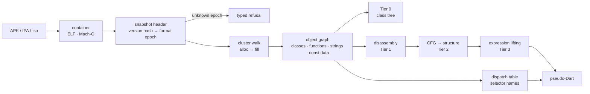

<h1 align="center"></h1>

[](LICENSE)
[](#install)
[](#tests)

**A Flutter decompiler.** Point it at an APK and get back a class tree, method bodies as
pseudo-Dart, the string pool, embedded data tables, and the source names of virtual calls.

It is for reverse engineers, security reviewers, and anyone auditing a shipped Flutter app
who has hit the wall where most tools stop at ARM64 assembly.

Flutter compiles Dart ahead of time. There is no bytecode and no reflection metadata, so
teams ship banking, fintech, health and identity logic on the assumption that AOT hides it.
It does not. The public toolchain is simply fragmented, version-fragile, and stops at
assembly.

**The rule that shapes everything here: Jadart never prints a confident guess.** An
instruction it does not model prints as raw arm64. A call argument it cannot reconstruct
prints `(...)`. A field whose name is not in the binary prints `field_0x8`. A Dart release
whose format is not registered raises a typed error instead of parsing with a grammar that
might be wrong. Gaps are visible on purpose, because a plausible wrong answer is worse than
a marked absence.

## Showcase

<table>
<tr><th>original Dart</th><th><code>jadart decompile libapp.so LicenseVault</code></th></tr>
<tr><td>

```dart
class LicenseVault {
  int balance = 1000;

  bool withdraw(int amount) {
    if (amount > balance) return false;
    balance -= amount;
    return true;
  }

  int checksum(List<int> data) {
    int acc = 0;
    for (int i = 0;
         i < data.length; i++) {
      acc = (acc * 31 + data[i])
            & 0xffffffff;
    }
    return acc;
  }

  String classify(int score) {
    if (score < 0) return 'invalid';
    if (score < 40) return 'weak';
    if (score < 80) return 'fair';
    return 'strong';
  }
}
```

</td><td>

```dart
class LicenseVault {

  withdraw() {
    if (this.field_0x8 < 0xfa) {
      return false;
    } else {
      this.field_0x8 -= 250;
      return true;
    }
  }
  checksum(a1) {
    var t0 = 0;
    var t1 = a1.field_0xc;
    var t3 = a1.field_0xc.field_0x8
             .toSigned(32) >> 1;
    var t4 = 0;
    while (true) {
      if (t4 >= t3) break;
      t0 = ((t0 * 31 & 0xffffffff)
            + (t1[t4] & 0xffffffff))
           .toUnsigned(32) & 0xffffffff;
      t4 += 1;
    }
    return t0;
  }
  classify(a1) {
    if ((a1 >> 63) & 1 != 0) {
      return "invalid";
    } else {
      if (a1 < 0x28) {
        return "weak";
      } else {
        if (a1 < 0x50) {
          return "fair";
        } else {
          return "strong";
        }
      }
    }
  }
}
```

</td></tr></table>

Each one shows a real property of the format:

- The string literals come back verbatim. `--obfuscate` does not encrypt them.
- `balance` renders as `this.field_0x8`, because THIS field's `Field` object did not
  survive: the string `balance` is not in the binary at all. Some fields do survive with
  their offsets and those are printed by name; see [Limits](#limits) for which and how many.
- `withdraw`'s parameter shows up as the constant `250`. The program's only call is
  `_vault.withdraw(250)`, so that is what the compiled code contains, and `withdraw()`
  lists no argument because the body never reads one. Jadart shows you the compiled
  program, not the source you wish it were.
- `score` is `a1`: the argument register it arrived in, x2, counted from the receiver's
  slot, which is also its position in a call's printed list. The body reads it before
  writing it, so it is an argument by the calling convention the call sites are already
  read with. Its Dart name and type are not in the binary, so neither is invented.
- The comparison flipped: `amount > balance` compiled to `balance < 250`, and Jadart
  prints what the branch actually tests.
- A `t` name is a value the lifter proved and an `a` name is an argument still holding
  what the function was entered with; a bare `x2` is one it could not prove, and 6.7% of
  the clean fixture's lifted lines still carry one. Nothing is spelled better than it is
  known.

## How it fits together



New to the format? [docs/how-flutter-works.md](docs/how-flutter-works.md) explains what a
Flutter app actually is on disk, how Dart gets compiled into it, and why that makes it hard
to read. [HOW-IT-WORKS.md](HOW-IT-WORKS.md) then walks the whole pipeline above end to end.

## Install

```bash
git clone https://github.com/IR0NBYTE/Jadart.git
pip install './Jadart/framework[disasm]'   # capstone is optional; the snapshot layer works without it
```

Python 3.9 or newer. The snapshot layer has no dependencies at all; `[disasm]` pulls in
capstone for the instruction-level commands.

## Quickstart

```bash
jadart info app.apk                        # is this Flutter, and is the format supported?
jadart verify app.apk                      # byte-exact gates: did the parse really work?
jadart classes app.apk -f Vault            # Tier 0 class, method and field tree
jadart decompile app.apk LicenseVault      # a whole class, as pseudo-Dart
jadart lift app.apk withdraw               # one function
jadart strings app.apk -g password         # the identifier and literal pool
jadart constants app.apk                   # embedded data tables, elements and all
jadart constants app.apk @0xb9b0           # the one table a body names, whole
jadart xrefs app.apk "some literal"        # who references it
jadart export app.apk out/                 # the whole browsable tree on disk
jadart symbols app.apk --format r2         # name every function in radare2 (also ida, ghidra)
jadart hook app.apk Vault.unlock           # a Frida script that logs that function's calls
```

It takes an APK, a directory or a bare `libapp.so`. You do not unzip anything first, and
iOS builds work the same way (see [platform support](#platform-and-version-support)).

`-j` gives JSON on any command, errors included, so a caller never parses stderr.
It is one document on one line when stdout is a pipe or a file, which is how a script or
an agent reads it, and indented by two spaces only when stdout is a terminal. The value
is the same either way.
Exit code is `0` on success, `1` when nothing in the binary matched what you asked for
or an acceptance gate failed, `2` when the input will not parse or the command line is
wrong, `3` when jadart itself has a bug, which is never your file's fault, and `130`
when interrupted.

Full walkthroughs: [docs/usage.md](docs/usage.md). Per-command help: `jadart <cmd> --help`.

## What it recovers, tier by tier

| tier | what you get | honest fallback |
|------|--------------|-----------------|
| 0 | class / method / field skeleton with the resolved superclass hierarchy (`FluBenchApp extends StatelessWidget`). 1843 named classes, 5779 members, 9013 strings on the clean corpus | classes whose names were stripped keep their structure |
| 1 | per-function arm64 with direct call targets named and ObjectPool constants resolved to their string or function, including far pool loads (`add xD, x27, #hi; ldr [xD, #lo]`) | unresolved pool slots print their raw offset |
| 2 | `if`/`else` and loops reconstructed as pseudo-Dart from the CFG, using forward and post-dominators, plus a Cifuentes follow node for the 38.5% of conditionals whose arms each end in their own `return` and so post-dominate at the virtual exit | 1,414 of 8,194 functions (17.3%) print at least one `goto`, and 201 of them hold a region that is genuinely irreducible, where no `goto`-free rendering exists at all. `tools/cfgcheck.py` reads the structured tree back as a program and checks, for every block in the image, that the rendering claims exactly the successors the CFG has |
| 3 | expressions, by abstract interpretation over the register file: field load/store, arithmetic, `bool`/`null`/int constants, element access, compound `-=`, `return <expr>`, and scalar floating point (including int-to-double and double-to-int conversions, and `math.max`) | any instruction the lifter doesn't model prints as its arm64 line |
| 3.1 | call arguments from the callee's register arity, read at the target address and so not dependent on the callee having a recovered name (`benchWithdraw(t9, (t4.toSigned(32) >> 1) ~/ 2)`). A call whose result is read gets that result named, so the value can be followed to its use. The function being lifted is read the same way: an argument register its body reads before writing is named by its slot, `a1`, and the signature lists them, `checksum(a1)`, which takes the clean fixture's lines carrying a bare register from 19,446 to 12,289 | the stack convention, an arguments descriptor, and a target outside the image print `(...)` rather than a guess, at the call and in the signature alike |
| 3.2 | VM runtime stubs rendered as source operations: `throw`, `throw NullCastError()`, `new List()`. A stub is identified by its index in the snapshot's object-store roots, so this works on a plain `--release` build, which keeps no symbol and no `Function` for one: 76 stubs named on each fixture, taking the clean image's `(...)` calls from 9,196 to 5,139. A `Class` owns exactly one kind of code, its own allocation stub, so the `bl` that allocated a value says which class it is: 3,848 of the clean fixture's 4,425 `new` sites print a class. Pure machinery is stripped so it never reaches output: frame setup, the stack-overflow check, the write barrier, type tests, and the Smi box-or-tag idiom, which surfaces as a bogus `if (x != x)` if you leave it in | anything else stays a named `bl` |
| 3.3 | virtual and interface calls attributed to a receiver plus a stable selector offset, `x1.sel_0xb34(...)`. 2,580 of the clean fixture's 3,333 dispatch sites recover both (77.4%) | the rest print `(dynamic call)` |
| 3.4 | that offset resolved to a **source selector name**: `x2.toString()`, `x2.addListener(...)`. 133 selectors on the clean corpus, naming 23.5% of the dispatch sites that have a recovered offset | names need two agreeing classes, an untied vote AND an offset no other function is known to be placed at, so the rest keep `sel_0x<off>` |

Two things sit outside the tier ladder and matter a lot in practice.

**Full-image disassembly coverage.** Fixing the instruction-table walk to size a
function by the next table entry, across all entries rather than only recovered owners,
took obfuscated builds from 4% to 100% of the instruction image. Functions discarded by
`--obfuscate` keep their instructions and lose only their Code object.

**ELF and DWARF name backfill.** A default `flutter build --release` turns on
`dwarf_stack_traces_mode`, which strips Dart names out of the snapshot and emits them into
the ELF `.symtab` instead. Snapshot-only recovery on such a build yields short hash tokens
like `AB` and `Aba`. Jadart maps each recovered code range back to the covering symbol. On
a real third-party app that recovered **9666 real function names** the snapshot no longer
held, alongside 7225 string literals and 100% disassembly coverage over 11052 ranges. This
needs a `.so` that still has a symbol table: an unstripped build intermediate, a debug
`.so`, or a matching `--split-debug-info` file. A fully stripped shipped `.so` loses those
names for every tool.

Selector naming is not a heuristic. A method defined in class `C` occupies `C`'s own
dispatch row, so `selector_offset = k - cid(C)`, and every class defining that same
selector must independently produce the same number. On the corpus `get:hashCode` is
corroborated by 127 distinct defining classes, `toString` by 67, `build` by 48,
`createState` by 46, `createRenderObject` by 42, `dispose` by 40. That is the whole
Flutter widget lifecycle, each at its own offset. A name needs at least two agreeing
classes, and an offset claimed by two different names is dropped.


## Platform and version support

| target | container | pointers | status |
|---|---|---|---|
| Android arm64 | ELF64 | compressed | supported, every applicable Tier-A gate |
| x86_64 (emulator, desktop) | ELF64 | compressed | supported; structure only |
| iOS / macOS arm64 | Mach-O 64 | uncompressed | supported, every applicable Tier-A gate |
| Android arm32 (`armeabi-v7a`) | ELF32 | uncompressed | Tiers 1 and 2 decode; Tier 3 refuses |

**Nineteen registered format epochs**, Dart 2.19 through 3.13.0, across fifteen grammar
families. Two are beta builds, because Flutter's beta channel pins a Dart release of its
own and an app published from it carries that hash forever. An unregistered release fails
loud with the hash and the command that would identify it.

Dart 3.13 is the newest, and it is registered for 64-bit compressed pointers only. That
is the target of the one 3.13 binary there was to gate it on, an Android arm64 app; a
3.13 build for iOS or arm32 is refused by name until one has been through `verify`.

Detail and reasoning: [docs/support.md](docs/support.md).

## How fast

Every command is a fresh process that parses the snapshot from scratch, so these are the
prices a script or an agent pays per call, not warm numbers.

<!-- bench:start -->
| workload | what it does | median | peak RSS |
|---|---|---|---|
| `info` | header and epoch only | 0.04 s | 26 MB |
| `classes` | Tier 0 skeleton (snapshot layer only) | 0.10 s | 42 MB |
| `strings` | the identifier pool | 0.10 s | 38 MB |
| `functions` | the call graph over the whole image | 0.46 s | 66 MB |
| `xrefs` | who loads this string | 0.16 s | 50 MB |
| `export` | Tier 3 source tree for the whole binary | 4.55 s | 73 MB |
| `exportobf` | the same on an --obfuscate build | 0.19 s | 48 MB |
| `lift` | Tier 3 for every code range, digest included | 5.75 s | 74 MB |

Median of 7 fresh processes on the FluBench fixtures (clean 3.1 MB, obf 2.6 MB), Apple M4
Max, Python 3.14.7, jadart 1.1.0, taken 2026-09-26 with `tools/bench.py --baseline`.

`./check.sh --full` reruns these against the same file and fails when a median grows past
1.5x its baseline or peak RSS past 1.25x, so the table cannot go stale quietly.
<!-- bench:end -->

## Why "it parsed" is not evidence

A snapshot parser that guesses wrong does not crash. It produces a plausible, entirely
fictional object graph. So Jadart ships byte-exact acceptance gates: `jadart verify` walks
the clusters and checks each one ends exactly where the format says it must, cross-checks
recovered field offsets against the displacement the field's own implicit getter compiled
to, and refuses rather than reports when a check cannot be understood.

The gates run on the committed fixtures, alongside a determinism diff across two
`PYTHONHASHSEED` values and differential oracles that execute the printed pseudo-Dart
against an emulated CPU and compare it to the real one. `.github/workflows/tests.yml`
runs the gates, the determinism diff and the suite on every pull request and every push
to main. The oracles need unicorn, which it does not install, so run those yourself
before a release.

The full evaluation, including the comparison against `unflutter`, Blutter, Ghidra and
radare2, is in [EVAL.md](EVAL.md).

## Limits

Everything below is measured, not assumed. Jadart fails loud rather than filling gaps with
plausible output.

**Original source is unrecoverable.** AOT discards the AST. The realistic target is typed,
named pseudo-Dart, and that is what Jadart aims at.

**Most instance field names are gone, and a minority are not.** This page said "gone,
permanently" until it was measured properly, and that was wrong in a way worth spelling
out. What is true: the `offset_in_words_to_field` table is empty across all 2350 classes
in the corpus, only 420 of the program's several-thousand fields keep a `Field` object at
all, and `balance` is absent from the entire string pool, so `BenchAccount.balance` really
is unrecoverable and renders `this.field_0x8`.

What is false is the generalisation that followed. Of those 420 `Field` objects 245 are
INSTANCE fields, not statics, and each records its own byte offset (`Smi::New(
Field::TargetOffsetOf(field))`, app_snapshot.cc:2238). Across the 44 cached third-party
apps it is 36,555 instance fields of 59,160. So Jadart prints the name where the snapshot
supplies one and the base's class is known, and the offset everywhere else:

```
$ jadart classes libapp.so -f PointerEvent

class PointerEvent extends ... {
  distance;      // @0x58 unboxed
  distanceMax;   // @0x60 unboxed
  transform;     // @0xa4
```

A field keeps its `Field` object when something still points at it: 162 of the corpus's
245 are the `data` of a surviving implicit getter, implicit setter, or field initializer.
Everything the optimiser inlined away is gone, which is why the map reaches a minority of
the accesses and not all of them: 17.1% of the `this` lines on Hacki, 18.0% on com.k.todo,
and 14.9% on the committed clean fixture, 1,598 of the 10,758 lines that would otherwise
carry a `this.field_0x`.

Two further channels reach slots those `Field` objects do not, and both read a statement
the snapshot makes rather than inferring one. A `Class` owns exactly one kind of code, its
own allocation stub, so the `bl` that allocated a value says which class it is, which is
what gives a base other than `this` a class at all. And an implicit getter or setter, the
one the compiler makes for a field and names after it, still names that field's slot
where the `Field` survives but its own name is a string only the VM snapshot holds:
`Color`'s `r`, `g` and `b`. A hand-written setter is not read, because Dart forbids a
field and a setter of one name in one class, so `set capacity` stores into `_capacity`.
Together the three take the clean fixture's byte-offset field lines from 55,089 to 53,463,
the map 871 of them, the accessors 49 more and the allocation stubs 706 more. The map's
share includes the methods a `PatchClass` owns, what a mixin application takes from its
mixin and what a patch file adds to a core class, whose receiver class is the class the
`PatchClass` wraps (`Function::Owner`): 397 functions and 103 lines on that fixture. One
disagreement refuses a whole channel: on that fixture the implicit accessors agree with
the `Field` objects that name themselves 145 times out of 145, and the wrapped class
agrees with the receiver type the function's own signature declares 25 times out of 25.

A cast states a fourth base's class, on the edges after it. `x as C` calls C's
type-testing stub, which returns only if the value is assignable, and where no class
implements C every subtype extends it and keeps C's fields where C has them, so
`return t2.field_0x8.field_0x14;` in `childAfter` prints
`return t2.field_0x8.nextSibling;` after `parentData as FlexParentData`. The name is
printed only where every path to the access proves the class, and each piece of evidence
is checked against a second one: the implemented bit against the `interfaces` arrays,
and every specialised stub's own code against the class's subclasses. On the clean
fixture that names 96 accesses no other channel names, taking the byte-offset field lines
from 52,626 to 52,556, and 305 to 496 on each of the seven app-sweep libraries.

**Nineteen supported epochs today**, 2.19 through 3.13.0. This paragraph used to say
"one, and three more identified and refused"; that was true when it was written and stopped
being true without being updated, which is the failure mode a README has and a test does
not. Nothing is currently identified-but-refused (`versions._UNVALIDATED` is empty). One
hash found in the wild is still unplaced and is bracketed rather than guessed at: its
feature string dates it to a Dart 3.5.x-3.8.x dev build. Adding an epoch is a bounded task,
not an open question, because `verify` decides when it is right.

**Obfuscation removes the app's own names permanently.** `--obfuscate` removes about 43%
of snapshot objects, which are the identifier strings, so name recall from the binary
drops to roughly 2% for every tool. Jadart keeps 100% string-literal recall and 100%
disassembly coverage there, and selector naming degrades to roughly 1 name because the
corroboration vote needs identifiers to count. `dwarf_stack_traces_mode` builds also yield
about 1 selector: the `.symtab` still has the real names, but only 245 of 2175 Functions
keep the snapshot `Code` to owner-`Class` link the offset arithmetic needs. Both degrade
to the Tier 3.3 rendering, never to a guess. `--sigs` recovers the *library* half of that
loss from a reference build (see [Naming library code](docs/usage.md#naming-library-code-that-was-obfuscated-away));
the app's own functions stay anonymous, because no reference contains them.

**No UI.** Jadart is a CLI. A navigable viewer is on the roadmap, not in the box.

**Arguments and unmodelled instructions are marked, not invented.** Calls using the stack
convention print `(...)`. Any instruction the lifter doesn't model prints as arm64. The
whole annotate, strip, CFG, structure, lift pipeline runs with **zero exceptions over
16,382 code ranges**, the clean build's 8,194 and the obfuscated build's 8,188, and over a
real third-party app.


## Using it from a coding agent

Jadart is a CLI that prints text, so any agent that can run a shell command can drive it.
What an agent cannot do on its own is know when a gap in the output is deliberate, and
that is the failure worth preventing: shown `x1.sel_0xb34(...)`, the natural move is to
say what it "probably" does, which turns a careful analysis into a confident fabrication
carrying the authority of a byte-exact tool.

[`skills/flutter-reverse-engineering/`](skills/flutter-reverse-engineering/SKILL.md) is a
skill that teaches exactly that. It routes each question to the command that answers it,
and spends most of its length on how to read a gap.

**Claude Code.** Copy the directory into your skills folder and it loads on the next run:

```bash
cp -r skills/flutter-reverse-engineering ~/.claude/skills/     # every project
cp -r skills/flutter-reverse-engineering .claude/skills/       # just this one
```

Then ask for the work in your own words. "Audit this APK for hardcoded secrets" matches
the skill's description and it applies itself; `/flutter-reverse-engineering` invokes it
by name.

**Anything else.** The file is plain Markdown with a YAML header, and nothing in the body
is vendor-specific. Cursor, Copilot, Cline, OpenAI's Agents SDK and a hand-rolled tool loop
all take the same content, as a system prompt, a rule file, or whatever that runtime calls
its instructions. Point it at a binary and give the agent a shell.

The one thing to keep, whatever you paste it into, is the rule at the top: never fill in a
gap the tool deliberately left. Everything else is routing.

## Documentation

| document | what is in it |
|---|---|
| [docs/how-flutter-works.md](docs/how-flutter-works.md) | how a Flutter app is built and what ships, with diagrams |
| [HOW-IT-WORKS.md](HOW-IT-WORKS.md) | the whole Jadart pipeline, end to end |
| [docs/usage.md](docs/usage.md) | command walkthroughs |
| [docs/support.md](docs/support.md) | platform and version support in detail |
| [DESIGN.md](DESIGN.md) | the annotated Dart AOT snapshot format, cited to dart-lang/sdk |
| [EVAL.md](EVAL.md) | evaluation against existing tools, and the failure taxonomy |
| [skills/](skills/flutter-reverse-engineering/SKILL.md) | a portable Flutter reverse-engineering skill for coding agents |
| [CHANGELOG.md](CHANGELOG.md) | what changed, and what the version number covers |
| [CONTRIBUTING.md](CONTRIBUTING.md) | how to add an epoch, a grammar or a gate |

## Repository layout

```
framework/            jadart itself, plus its test suite
  jadart/             containers (elf, macho, container), the snapshot stream
                      (stream, versions, cids, cidtables, snapshot, clusters,
                      fillwalk, fill, fields, program, symbols), the decompiler
                      (disasm, cfg, expr, dispatch, callgraph, signatures, ir,
                      ssa, lower), the gates (verify), and the CLI (cli, console,
                      export, errors)
  tools/              gen_cids, gen_epoch, sdk_source, build_corpus, measure,
                      cfgcheck, irfuzz, appsweep, ctfbench, bench, quality, semdiff,
                      fencecheck
  tests/test_core.py  validation against the FluBench corpus
flubench/             the controlled corpus: a labelled construct app and its harness
  app/                the Flutter app whose declared symbols are exact ground truth
  artifacts/          the arm64 fixtures, clean and --obfuscate
  corpus/             one build per distinct snapshot hash (regenerate, not committed)
docs/                 usage, support, the Flutter internals explainer, and the logo
```

## Tests

```bash
cd framework && python3 -m pytest tests -q     # 579 tests
./check.sh                                     # the suite, the gates, the measured claims
./check.sh --full                              # adds the CFG edge check, determinism, the bench
```

Some tests need something this repository does not ship: a multi-version corpus, an
`--obfuscate` build of another app, `unicorn` for the differential oracles. Those skip
with the reason named, and pytest reports them as skips rather than passes. On a fresh
clone with capstone installed, expect about 545 of the 579 to run and the other 34 to
skip for one of those reasons.

The arm64 FluBench fixtures, clean and `--obfuscate`, are committed, so a fresh clone runs
the suite with no Flutter install. Tests whose fixture is missing skip and say which one.
Rebuilding, or extending to more Dart versions, needs Flutter on `PATH`:

```bash
bash flubench/build.sh                          # the arm64 clean + obfuscated fixtures
python3 framework/tools/build_corpus.py --plan  # the multi-version hash table
```

`build_corpus.py` drives `frontend_server_aot` and `gen_snapshot` directly instead of
`flutter build apk`. Both ship inside every SDK, so a corpus build needs no Android
toolchain, no pinned JDK and no AGP.

## Contributing

Bug reports, new format epochs and new acceptance gates are all welcome. Start with
[CONTRIBUTING.md](CONTRIBUTING.md); the rule that matters most is that a claim arrives with
the measurement behind it.

## Licence

MIT. See [LICENSE](LICENSE).
